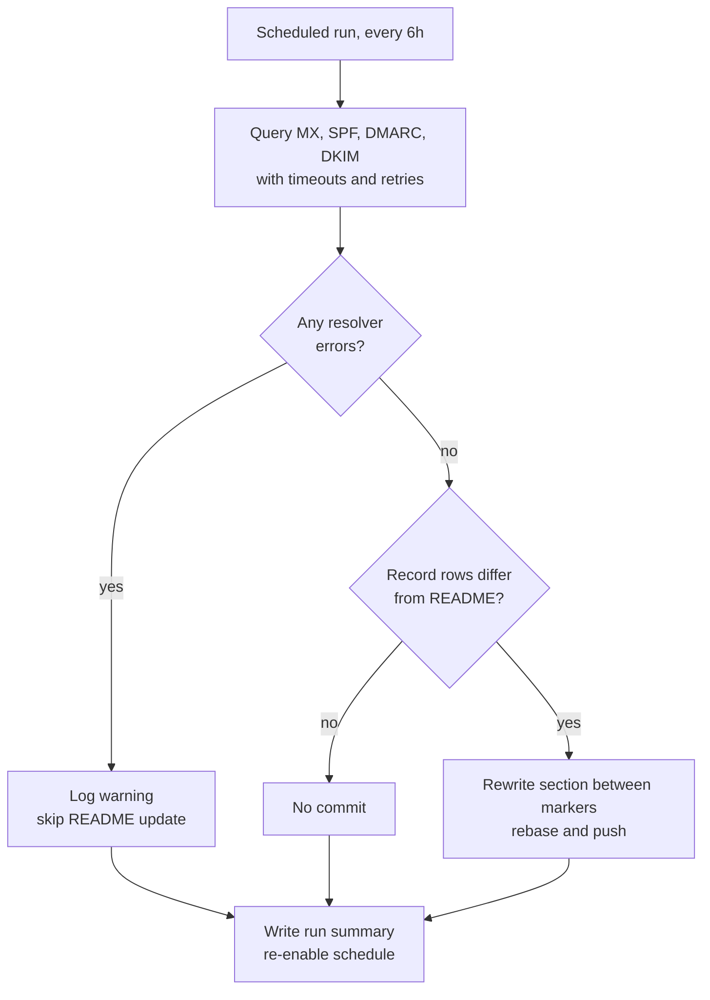

## Problem

Email authentication is three DNS records: SPF lists the servers allowed to send mail for a domain, DKIM publishes the key receivers use to check a message's signature, and DMARC tells receivers what to do with mail that fails those checks. It's set up once and then forgotten, until a DNS change or provider migration breaks it without warning and mail starts landing in spam. I wanted continuous, visible evidence that `jacksonasmith.com` stays correctly configured, published where people would see it: the live status table on my [GitHub profile](https://github.com/jackson-asmith).

## Existing state

The first version (January 2026) was a straightforward scheduled workflow. Every six hours it queried MX, SPF, DMARC, and common DKIM selectors, rendered a Markdown table with a timestamp, and wrote it into the profile README.

It worked, but it was noisy. The generated table included the current time, so every run produced a "change" and a commit. Between January and early April it made **about 350 commits**, and none of them reflected an actual DNS change.

## Constraints

* **Public by design.** Everything runs in a public repository against public DNS, so there's nothing sensitive to protect. But the output is public too, so wrong output is visible to anyone who looks.
* **No infrastructure.** No servers, no paid monitoring service. It uses only GitHub Actions and `dig`.
* **Unattended.** It had to keep working for months without anyone looking at it.

## Options considered

Each iteration came down to a decision about what the automation should do when things weren't clean:

| Decision point | Options | Chosen |
|---|---|---|
| When to commit | Every run · only when output differs · only when *records* differ | Only when record rows differ; the timestamp is excluded from the comparison |
| Resolver failure (timeout, SERVFAIL) | Treat it as "record missing" · fail the run · skip the update | Record the error and skip the README update |
| Schedule going dormant | Accept it · scheduled "keepalive" commits · re-enable the workflow through the API | Re-enable through the API on every run |

## Decision

*In words: every six hours the workflow queries MX, SPF, DMARC, and DKIM with timeouts and retries. If any query failed, it logs a warning and leaves the README alone. If the records match what's published, it doesn't commit. Otherwise it rewrites the table and pushes. Every run ends by writing a summary and re-enabling its own schedule.*

**Compare records, not output.** The fix for the commit noise was to compare only the MX, SPF, DMARC, and DKIM rows against what's already in the README. A new timestamp alone never triggers a commit.

**A resolver error is not a missing record.** In the original version, a DNS timeout left the value empty, which the workflow then reported as "not configured". A transient network error would have been published as a misconfiguration. The hardened version tracks query failures separately and refuses to update the README when any query failed.

**Stay alive without fake activity.** GitHub disables scheduled workflows after 60 days without repository activity. Once the commit noise was fixed, the workflow was *designed* to go quiet, which meant GitHub would switch it off. Rather than adding meaningless keepalive commits (the same noise I'd just removed), each run calls the Actions API to re-enable its own schedule. That only works while it's still running: if GitHub disables it anyway, nothing runs to turn it back on, and it has to be re-enabled by hand from the repository's Actions tab.

## Safeguards

* `set -euo pipefail`, and scoring written so that a non-passing check can't abort the run
* Timeouts and bounded retries on every DNS query (`+time=5 +tries=3`)
* DMARC policy parsing anchored to the start of a tag, so a subdomain policy (`sp=reject`) can't be mistaken for the domain policy (`p=`)
* MX results sorted by priority so the reported primary is stable between runs
* The workflow fails if the README's start/end markers are missing, instead of mangling the file
* A concurrency group plus rebase-before-push, so overlapping runs can't race each other
* Least-privilege permissions: `contents: write` for its own README and status file, and `actions: write` for the keepalive, nothing else
* A run summary written on every execution, even on failure

## Outcome

* Commit noise went from **about 350 commits in three months to one** in the months since the fix: the single commit came when the table format itself changed.
* A resolver failure can no longer overwrite the published status with a false missing-record result. The flip side: if every run fails, the last good status stays up, so the status shows what was last confirmed, which may not be what's true right now.
* It checks what's published in DNS: the MX, SPF, and DMARC records and a set of common DKIM selectors. It doesn't send and inspect a real message, so it can't confirm alignment for mail as delivered, or for a DKIM selector it doesn't know to check.
* The workflow keeps its own schedule alive without any manual intervention.
* **Update, September 29: it moved to [its own repository](https://github.com/jackson-asmith/email-alignment-checker), with its commit history.** The profile README can't keep showing a table this workflow writes unless the workflow gets a credential that can write to another repository. A long-lived token with write access, used by a job that runs unattended four times a day, is more risk than a status table is worth. So the workflow now also publishes a small `status.json`, and the profile shows it as a badge that reads that file. It follows the same rules as the table: it changes only when the records do, and a run with any resolver error publishes nothing. The trade-offs are recorded in an architecture decision record, [ADR 0001](https://github.com/jackson-asmith/email-alignment-checker/blob/main/docs/adr/0001-publish-status-as-a-badge.md).

## Principles demonstrated

* **[Automation must reduce risk, not create it](/principles/#2-automation-must-reduce-risk-not-create-it):** the most important change was teaching the workflow the difference between "I couldn't check" and "it's broken", which mattered more than any new feature.
* **[Reliability is a feature](/principles/#1-reliability-is-a-feature):** it runs unattended, fails safe, and keeps itself running.
* **[Testing comes before trust](/principles/#5-testing-comes-before-trust):** each fix came from checking what the automation did instead of assuming it worked. The next item below is where that's still unfinished.

## Lessons learned

* **Output that includes the time is never stable.** Any change detection has to compare the data, not the rendered output.
* **"Empty" is ambiguous.** Distinguish "absent" from "unknown" as early as possible, and let unknown block consequential actions.
* **Fixing one problem can create another.** Making the workflow quiet is what exposed the inactivity shutdown. It's worth asking what else depended on the old behavior.
* **What I'd do next:**
  * Move the parsing logic out of inline YAML into a script with unit tests covering SPF, DMARC, and resolver-failure cases.
