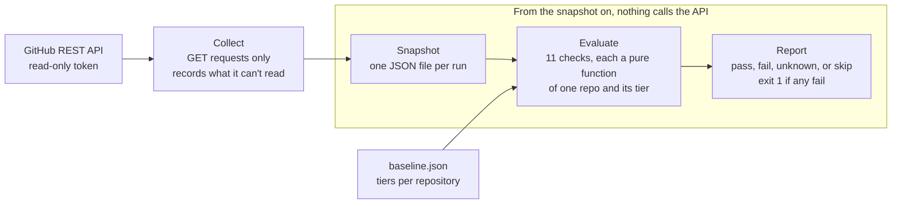

One of my repositories required four status checks before anything could merge, and anything allowed to post a commit status could have satisfied them, whether or not the checks ever ran. Two others, untouched since 2020, still had deploy and publish workflows that referenced cloud and package-registry secrets. I found all of it in a one-day audit of my public GitHub repositories, then turned that audit into [gh-baseline](https://github.com/jackson-asmith/gh-baseline), a `gh` extension that reports where repositories drift from a baseline you declare once, in a file.

I wrote it in Go, a language I don't know, with an LLM writing most of the code. Below is how the audit became a tool, the decisions behind it, and where my judgment mattered more than the language did.

## Problem

Repositories drift. A new one starts with no protection at all, settings that were right when a repo was active stay frozen after it goes quiet, and nobody rechecks what they set up years ago. GitHub shows these settings one repository and one page at a time, so a full review means a dozen settings pages per repo.

The goal was a baseline I could state once and check any time: which protections each repository should have, and every place it differs. It had to be honest about what it couldn't see, because a security check that guesses "pass" is worse than no check.

## Existing state

I audited all 11 of my public repositories by hand: 9 of my own and 2 forks. For each one I read the default branch's rulesets, the security settings, and every workflow file. Most of it was what you'd expect from repositories built at different times with different habits:

| Finding | Repositories | Why it matters |
|---|---|---|
| Private vulnerability reporting off | 11 of 11 | No private way for anyone to report a problem |
| Dependabot security updates off | 11 of 11 | Known-vulnerable dependencies wait for me to notice |
| Default branch unprotected | 7 of 11 | Anyone with push access can delete it or force-push over it |
| Actions referenced by tag, not commit SHA | 5 of 8 with workflows | A moved tag runs new code with the workflow's permissions |
| Secret scanning and push protection off | 5 of 11 | A committed credential goes unnoticed |
| Workflows with no `permissions:` block | 4 of 8 with workflows | The job token gets the repository default, which may be write |
| Required checks that accept any source | 1 (4 checks) | Any app or token that can post a status can satisfy them |
| Stale repos whose workflows reference secrets | 2 | If the secrets are set, credentials outlive the project that used them |

The last two were the surprises. The required checks looked like strong protection in the settings page; the source field read "Any source" and nothing flagged it. The stale repos were from 2020. One was a fork from a virtual conference, with a workflow written to run `terraform apply` with an Azure service principal on every push to an unprotected branch. The other was a Ruby log analyzer from the course where I learned git and Ruby, and it published a gem from a workflow that also ran on pull requests.

The fork turned out to be less dangerous than it looked. I had never set its secrets, so the workflow had nothing to authenticate with. The audit couldn't tell that from the outside, and neither can the tool: both see that a workflow references a secret, not whether the secret exists.

I fixed the 8 repositories I still care about the same afternoon, through settings and four pull requests that pinned actions, restricted workflow tokens, and added Dependabot. The fixes were quick. Finding the problems took the day, and nothing would stop them from coming back.

## Constraints

* **Read-only.** The tool runs with a token that can read repository administration settings. It should never be able to change them, and its reports should be safe to run on a schedule.
* **The API doesn't show everything.** Some settings, such as Dependabot malware alerts and the default permissions of the workflow token, aren't readable through the REST API with this kind of token. Others depend on the plan: rulesets on private repositories need a paid plan.
* **One status code covers different refusals.** On a private repository, reading branch rules returns HTTP 403 on a free plan, where nothing can be fixed. GitHub also uses 403 for other refusals, such as organization SAML enforcement, where protection might be missing. The message is what tells them apart.
* **Its own supply chain.** A tool that audits action pinning and Dependabot coverage shouldn't arrive with a dependency tree of its own.
* **I don't know Go.** At work I mostly write cross-platform PowerShell, .NET, and Python against APIs. I chose Go because it builds a single binary for `gh` to install and because it's a language I want to grow into, which meant relying on an LLM for the code and putting my effort into design, tests, and review.

## Options considered

| Decision point | Options | Chosen |
|---|---|---|
| What "good" means | One checklist for every repo · a baseline file with tiers | Tiers, assigned per repository |
| What to do with a setting it can't read | Treat it as passing · fail the run · report it | Report it as `unknown`, never `pass` |
| One repository can't be read | Stop the whole run · record it and continue | Record it; stop only for a rate limit or cancellation |
| A 403 on a private repo's rules | Any 403 means free plan · look up the account's plan · classify by GitHub's message | Classify by message, in one place |
| Dependencies | `go-gh` and a YAML parser · standard library only | Standard library only |
| Existing tools | Use OpenSSF Scorecard · build something owner-focused | Build it, and say how it differs |
| Distribution | `go install` · a script extension · precompiled release binaries | Precompiled binaries through `gh extension install` |

Tiers came straight from the audit. A repository with CI should require a pull request and passing checks, but one whose scheduled workflow commits straight to the default branch can't require a pull request at all. One checklist would have been wrong for one of them.

[Scorecard](https://github.com/ossf/scorecard) was the closest existing tool, and it checks some of the same workflow patterns. It scores a project from the outside. I wanted an owner's view across all my repositories, including settings an outsider can't see, like where a required check's result is allowed to come from.

## Decision

gh-baseline collects each repository's state into one snapshot, then evaluates that snapshot against a tiered baseline file. Only collection touches the network.



Because no check calls the API, every check is tested against fixture snapshots, and a saved snapshot can be re-evaluated after editing the baseline without collecting again.

The baseline names the tiers and assigns repositories to them. Every tier requires the default branch to block deletion and force pushes; the higher tiers add a pull request and required checks:

```json
{
  "defaultTier": "basic",
  "tiers": {
    "basic": { "requirePullRequest": false, "requireStatusChecks": false },
    "ci":    { "requirePullRequest": true,  "requireStatusChecks": true }
  },
  "repos": { "keel": "ci", "LinuxConfig": "ci" }
}
```

Each check reports one of four outcomes. `fail` comes with the fix. `unknown` means the data couldn't be read, and it's listed but doesn't fail the run. `skip` means the check doesn't apply, such as secret scanning on a private repository, where it's a paid feature. A repository that can't be read at all is `unknown` for every check rather than stopping the run, but an exhausted rate limit does stop it, with exit code 2 and the reset time, because every later request would fail the same way.

Plan limits are classified once, in the collector: a 403 on a private repository whose message says to upgrade is recorded as "rulesets unavailable" and skipped. Any other failure is an error, and the checks report it as `unknown`. The checks never read error text.

## Safeguards

* **It can't change anything.** The API client only sends GET requests, and the token it needs is read-only.
* **The token stays on GitHub.** The client refuses to follow an absolute URL outside the API host, so a crafted pagination link can't send the token somewhere else.
* **Retries can't repeat a change.** Every request is a GET, so retrying a timeout or a 5xx is safe. Retries follow the same bounded policy as [Keel](/projects/keel/): three attempts, exponential backoff with jitter, and `Retry-After` honored up to 60 seconds.
* **Blind spots are labeled.** Anything the API won't show is `unknown`, and the README lists what the tool can't see at all.
* **It follows its own baseline.** Its workflows pin actions by SHA, default to a read-only token, and grant `contents: write` only to the release job.
* **Decisions are written down.** Three [architecture decision records](https://github.com/jackson-asmith/gh-baseline/tree/main/docs/adr) explain the choices a reader would otherwise have to reverse-engineer: standard library only, how plan-limited rulesets are classified, and why releases ship precompiled binaries.

## Outcome

* **It reproduces the audit in one command.** On the 3 repositories I didn't fix, gh-baseline reproduced every finding the manual audit made, including both stale repositories and each secret their workflows reference, by name. The 8 repositories I hardened pass, except for two workflow findings in a fork that come from its upstream.
* **v0.1.0 is released.** Tagging it built 12 binaries for macOS, Linux, Windows, and FreeBSD, so `gh extension install jackson-asmith/gh-baseline` works without Go installed.
* **11 checks, about 100 passing test cases, no dependencies.** Roughly 1,400 lines of Go and 1,000 lines of tests. CI runs `gofmt`, `go vet`, and the tests under the race detector.
* **A test asserted something GitHub doesn't do.** Reviewing an early version, the LLM suggested deciding whether a private repository was on a free plan from the status code alone. A test already in the suite had a private repository returning 403 because the token lacked access, and I took that as proof the suggestion was wrong. It was an assumption, not proof. When I checked against the live API, the plan message matched exactly, but a token without access got 404, not 403. The design held up, since checking the message only ever errs toward `unknown`. The decision record now carries an amendment saying its original reasoning was wrong, and the tests say where each response came from.
* **A cleanup broke installation, and every check stayed green.** One round of changes deleted the release workflow. Tests passed and CI passed, but with no release binaries, the install command in the README would have failed. Review caught it before the first release, and an ADR now says why the workflow exists.
* **A constraint became a principle.** I started with no dependencies partly because the environment I built it in couldn't download Go modules. Once I thought it through, it was the right call anyway, and ADR 0001 records why, along with its cost: workflow files are read line by line instead of parsed as YAML.
* **The cleanup is done.** I deleted the fork, made the Ruby repository private, and confirmed my GitHub account has no live personal access tokens.

## Principles demonstrated

* **[Governance should enable engineers](/principles/#4-governance-should-enable-engineers):** the baseline is a file with tiers, not a single rulebook, so a repository gets the protection that fits how it's actually used, and every failure comes with the fix.
* **[Testing comes before trust](/principles/#5-testing-comes-before-trust):** checks are pure functions of a saved snapshot, tested against fixtures, and the tool was trusted only after it reproduced a manual audit's findings on real repositories.
* **[Automation must reduce risk, not create it](/principles/#2-automation-must-reduce-risk-not-create-it):** it's read-only, keeps its token on one host, and reports what it can't see instead of guessing.
* **[Documentation is engineering work](/principles/#6-documentation-is-engineering-work):** the design doc and three ADRs explain the trade-offs, so the next person doesn't "fix" the line-based workflow reader or the message match without knowing why they're there.

## Lessons learned

* **A setting that looks right isn't the same as one that is.** The "any source" checks passed every glance at the settings page. Most of what mattered in the audit was in a field nobody reads twice.
* **Your attack surface includes what you've forgotten.** The findings that looked worst weren't in my active projects. They were in two repositories I hadn't thought about in years.
* **A reference isn't a credential.** The finding that looked most dangerous, a fork wired to deploy to Azure, pointed at secrets that had never been set. Reading the workflow told me what it would do with a credential, not whether one existed. I only knew because I remembered never setting it up.
* **An LLM makes the code cheap, not the judgment.** It wrote most of the Go, and it wrote tests that encoded its own beliefs about GitHub's API, one of which was false. It also didn't notice that a passing build couldn't be installed. Tests written alongside the code share its assumptions, so the expected answer has to come from somewhere else: a manual audit, review, or the live API. That's where my time went.
* **"Unknown" keeps coming back.** In the [email alignment checker](/projects/email-alignment-checker/), an empty DNS answer wasn't a missing record. In [Keel](/projects/keel/), a timeout wasn't a failure. Here, a setting the API won't show isn't a pass. Each time, the fix was to give "I couldn't tell" its own outcome.
* **What I'd do next:**
  * Write SARIF output mostly by hand, with the LLM reviewing instead of writing, so findings appear in GitHub's Security tab and I write part of the Go myself.
  * Run it on a schedule against my own account and open an issue when anything drifts.
  * Choose tiers by topic or by whether a repository has CI, instead of listing names in the baseline.
  * Test against the real thing: a fixture snapshot whose expected findings come from the manual audit, fuzzing for the workflow parser, and a smoke test that runs the released binary.
  * Check whether referenced secrets exist. The API lists a repository's secret names without their values, so the stale-secrets check can separate a live credential from an empty reference.
